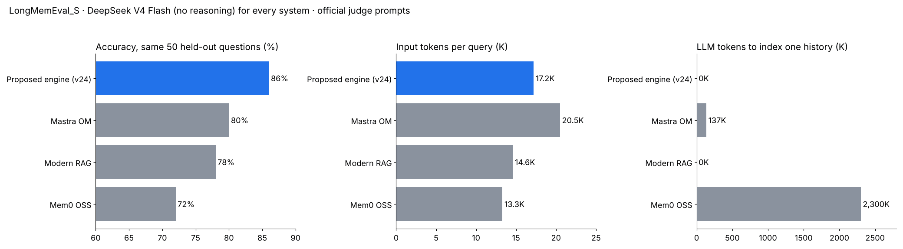

# Long-term memory for AI agents — LongMemEval results

All numbers measured with DeepSeek V4 Flash for every system, one answer per question, official LongMemEval judge prompts. The engine's code is not published; this repository contains results only.

## Headline

| Benchmark | Questions | Accuracy | Input tokens / query | Cost / question | LLM tokens to store memory |
|---|---|---|---|---|---|
| LongMemEval_S (development split) | 246 | **92.7 %** (macro 94.0 %) | 17.8K | ~$0.0057 | **0** |

Held-out confirmation pending. Per-question results: `even_design_set_v24.csv`.

| Type | Correct |
|---|---|
| knowledge-update | 39/39 |
| single-session-user | 34/35 |
| single-session-assistant | 23/24 |
| single-session-preference | 14/15 |
| temporal-reasoning | 61/66 |
| multi-session | 57/67 |

## Head-to-head (same 50 held-out questions, same model and judge)

| System | Accuracy | LLM tokens to store one history | Input tokens / query |
|---|---|---|---|
| This engine | 84 % | 0 | 14.6K |
| Mastra Observational Memory | 80 % | ~137K | 20.5K |
| Modern RAG | 78 % | 0 | 14.6K |
| Mem0 OSS | 72 % | ~2.3M | 13.3K |

n = 50. Per-question results: `head_to_head_50.csv`.

## Licensing

1-year licence, price on request. Verified through an independent evaluation without access to the code.

Arturo Hernández Martínez · arturohernandezmartinez000@gmail.com · Valencia, Spain

© 2026 Arturo Hernández Martínez. All rights reserved.
